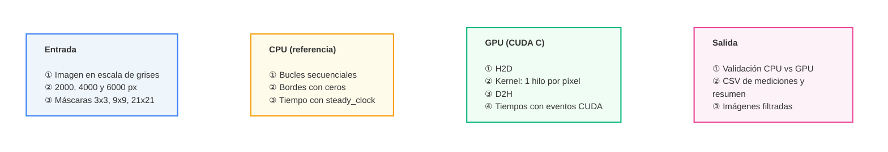

# Convolución de Imágenes de Alta Resolución en CPU y GPU (CUDA C)


**Práctica de Laboratorio 01 — PA 69 · Computación Paralela · Universidad Politécnica Salesiana**
Docente: Ing. Gabriel A. León Paredes, PhD.

<!-- TODO: agregar nombres de los integrantes de la pareja -->
Integrantes: **Sebastián Sinchi** (equipo ASUS) y **Rafael Serrano** (equipo Lenovo)

---

## RESUMEN (ABSTRACT)

**Problema:** La convolución de imágenes es una operación local en la que cada píxel de salida depende solo de su vecindad. Procesada de forma secuencial, el tiempo crece con el número de píxeles y con el tamaño de la máscara, lo que la hace costosa en imágenes de alta resolución.

**Propuesta:** Se implementan tres filtros (media, nitidez y laplaciano) en dos versiones funcionalmente equivalentes: una secuencial en C++ (CPU, referencia de validación) y una paralela en CUDA C, con un hilo por píxel de salida. Se valida numéricamente que ambas coinciden y se miden cuatro experimentos: filtros, resolución, tamaño de máscara e hilos por bloque.

**Tecnologías:** C++, CUDA C (`nvcc`), eventos CUDA para medir tiempos, `stb_image` / `stb_image_write` para leer y guardar imágenes.

**Resultados (equipo ASUS, RTX 3060 Laptop):** Las implementaciones coinciden con un error absoluto máximo ≤ 1,68·10⁻⁴ (tolerancia 10⁻²). Para media 9×9 en 4000×4000 el kernel es ≈ 200× más rápido que la CPU, pero con transferencias incluidas la aceleración total baja a ≈ 48×; con máscaras de 3×3 las transferencias son el ≈ 94 % del tiempo de GPU y la aceleración total es solo ≈ 8,6×. Las conclusiones se limitan al hardware y a las configuraciones evaluadas.

---

## ARQUITECTURA DE LA SOLUCIÓN



### Distribución del procesamiento en CUDA
- Bloques e hilos en el eje X, un hilo por píxel de salida.
- Índice global `idx = blockIdx.x * blockDim.x + threadIdx.x`; fila `idx / width`, columna `idx % width`.
- Los hilos con `idx >= width * height` no hacen nada; el número de bloques es `ceil(width*height / hilos_por_bloque)`.
- Imagen leída desde memoria global; arreglos de entrada y salida separados (la imagen original no se sobrescribe).
- Tratamiento de bordes: extensión con ceros (igual en CPU y GPU).

### Filtros implementados
| Filtro | Máscara |
|---|---|
| Media k×k | todos los coeficientes `1/(k·k)` (k = 3, 9, 21) |
| Nitidez 3×3 | `[0 -1 0; -1 5 -1; 0 -1 0]` |
| Laplaciano 3×3 | `[0 1 0; 1 -4 1; 0 1 0]` |

Conversión a rango visual (solo para guardar la imagen, después de validar): se recorta a [0, 255]; el laplaciano suma 128 antes de recortar para que los valores negativos sean visibles (por eso se ve mayormente gris).

---

## Equipos utilizados

### Equipo 1 — ASUS ROG Flow X16 (resultados de este README)
| Componente | Especificación |
|---|---|
| CPU | AMD Ryzen 9 6900HS (8 núcleos / 16 hilos, hasta 4,94 GHz) — se usa 1 hilo |
| RAM | 32 GiB |
| GPU | NVIDIA GeForce RTX 3060 Laptop (5857 MB, 30 SMs, cc 8.6) |
| Bus GPU | PCIe 16 GT/s, 8 carriles |
| Driver NVIDIA | 615.78.08 |
| SO | Arch Linux (kernel 7.2.11) |
| Compilador host | GCC 16.2.1 |
| CUDA runtime / driver | 13.4 / 13.4 |

### Equipo 2 — Lenovo (compañero)
| Componente | Especificación |
|---|---|
| CPU | AMD Ryzen 5 4600H (6 núcleos / 12 hilos, 3.00 GHz base) — se usa 1 hilo |
| RAM | 8,00 GB (7,37 GB utilizable) |
| GPU | NVIDIA GeForce GTX 1650 Laptop (4096 MiB / 4 GB, CC 7.5 Turing) |
| Driver NVIDIA | 617.42 (WDDM) |
| SO | Microsoft Windows |
| Compilador CUDA | nvcc release 12.8 (V12.8.61) · CUDA UMD 13.4 |

---

## Validación de resultados

Tolerancia: **10⁻²** (error absoluto). CPU y GPU hacen las mismas operaciones en `float` y en el mismo orden; solo pueden diferir por redondeo (contracción FMA). Cota teórica ≈ 441 · 6·10⁻⁸ · 255 ≈ 6,7·10⁻³ en el peor caso (21×21).

| Prueba | Descripción | Resultado |
|---|---|---|
| 1. Manual | Laplaciano sobre matriz 3×3 (valores 1–9), resultado calculado a mano vs CPU y GPU (4 hilos/bloque) | idéntico |
| 2. Dimensiones no múltiplos | Imagen 1237×911, 256 hilos/bloque, media 9×9 y nitidez; salida GPU inicializada con NaN para detectar píxeles sin procesar | 0 píxeles sin procesar, err. máx. 1,5·10⁻⁵ |
| 3. CPU vs GPU | En cada configuración, antes de convertir a imagen | err. máx. ≤ 1,68·10⁻⁴, err. medio ≤ 3,7·10⁻⁶ |

---

## Metodología de medición

- Por configuración: **1 calentamiento + 5 repeticiones medidas**; se reporta la **mediana** y la **desviación estándar**.
- GPU: tiempos separados H2D, kernel y D2H con eventos CUDA; `Tiempo_total_GPU = H2D + kernel + D2H`.
- CPU: `std::chrono::steady_clock`, implementación secuencial de un hilo.
- Excluido: lectura/escritura de archivos, visualización y preparación de imágenes. La reserva de memoria (`cudaMalloc`) se hace antes de medir y **no** está incluida. H2D incluye la imagen y la máscara.
- `Speedup_kernel = T_CPU / T_kernel` · `Speedup_total = T_CPU / T_total_GPU`.

---

## Resultados (ASUS, tiempos en ms, mediana de 5 repeticiones)

**Experimento 1 — Filtros** (4000×4000, 3×3, 256 hilos/bloque)

| Filtro | CPU | Kernel | Total GPU | Speedup kernel | Speedup total |
|---|---|---|---|---|---|
| Media | 97,6 | 0,704 | 11,39 | 138,5× | 8,6× |
| Nitidez | 98,7 | 0,707 | 11,47 | 139,8× | 8,6× |
| Laplaciano | 97,8 | 0,704 | 11,33 | 138,8× | 8,6× |

**Experimento 2 — Resolución** (media 9×9, 256 hilos/bloque)

| Resolución | CPU | Kernel | Total GPU | Speedup kernel | Speedup total |
|---|---|---|---|---|---|
| 2000×2000 | 194,3 | 0,995 | 3,89 | 195,2× | 49,9× |
| 4000×4000 | 779,6 | 3,928 | 16,11 | 198,5× | 48,4× |
| 6000×6000 | 1759,3 | 8,800 | 32,46 | 199,9× | 54,2× |

**Experimento 3 — Tamaño de máscara** (media, 4000×4000, 256 hilos/bloque)

| Máscara | CPU | Kernel | Total GPU | Transferencias | Speedup kernel | Speedup total |
|---|---|---|---|---|---|---|
| 3×3 | 98,9 | 0,702 | 12,99 | 95,3 % | 140,8× | 7,6× |
| 9×9 | 784,6 | 3,924 | 16,22 | 75,8 % | 199,9× | 48,4× |
| 21×21 | 4454,0 | 20,802 | 32,88 | 36,7 % | 214,1× | 135,5× |

**Experimento 4 — Hilos por bloque** (media 9×9, 4000×4000)

| Hilos/bloque | Bloques | Kernel | Total GPU |
|---|---|---|---|
| 128 | 125000 | 3,913 | 16,09 |
| 256 | 62500 | 3,922 | 16,09 |
| 512 | 31250 | 3,974 | 16,20 |

Hallazgos principales:
1. El tiempo crece linealmente con el número de píxeles (CPU y kernel).
2. Aumentar la máscara aumenta el trabajo por píxel y con él la ventaja de la GPU.
3. Con poco cómputo por píxel las transferencias dominan el tiempo de GPU (≈ 94 % con 3×3, ≈ 37 % con 21×21).
4. Los hilos por bloque casi no influyen: 128 es la mejor, por ≈ 0,2 % frente a 256 y ≈ 1,5 % frente a 512.
5. El kernel es muy estable (desviación < 0,2 %); la CPU varía entre 0,2 % y 3,4 %.


### Imágenes de salida (4000×4000)

<!-- imagen: exp1_media_4000x4000_3x3 (media 3x3 aplicada a prueba_4000) -->

<!-- imagen: exp1_nitidez_4000x4000_3x3 (nitidez 3x3) -->

<!-- imagen: exp1_laplaciano_4000x4000_3x3 (laplaciano 3x3 con +128; se ve mayormente gris porque la imagen es suave) -->

<!-- imagen: gráfica de speedup kernel vs total por experimento (si se genera) -->

---|---|---|
|  |  |  |

---

## Compilación y ejecución

### Prerrequisitos
- NVIDIA GPU con driver instalado y **CUDA Toolkit** (`nvcc`)
- Compilador C++ compatible con la versión de CUDA
- `stb_image.h` y `stb_image_write.h` (ya incluidos en `src/`)
- Imágenes de entrada en `imagenes/entrada/`: `prueba_2000.jpeg`, `prueba_4000.jpeg` y `prueba_6000.jpeg` (no están en el repositorio)
<!-- TODO: indicar de dónde descargar la foto original (enlace) y cómo generar las 3 versiones -->

### Compilar (desde la raíz del proyecto)
```bash
nvcc -O2 src/convolucion.cu -o bin/convolucion.bin
```

### Ejecutar (desde la raíz del proyecto, las rutas son relativas)
```bash
./bin/convolucion.bin
```
El programa ejecuta primero la validación y, si pasa, los cuatro experimentos. Genera:
- `datos/mediciones.csv` — registros originales de cada repetición
- `datos/resumen.csv` — medianas, desviaciones, speedups y errores por configuración
- `imagenes/salida/` — imágenes filtradas

> Duración aproximada: 3 minutos (la CPU con máscara 21×21 es la parte más lenta).

---

## Preparación de datos

Las imágenes de entrada (`imagenes/entrada/`, no incluidas en el repositorio) son versiones de una misma foto (`imagenes/originales/`) recortada en cuadrado y redimensionada a 2000×2000, 4000×4000 y 6000×6000; el programa las convierte a escala de grises al leerlas.
<!-- TODO: documentar el procedimiento exacto (herramienta, recorte, método de redimensionado) -->

---

## 📂 Estructura del Repositorio

```
├── src/                      # Código fuente CUDA C/C++ y librerías stb
│   ├── convolucion.cu
│   ├── stb_image.h
│   └── stb_image_write.h
├── datos/
│   ├── Asus/                 # mediciones.csv y resumen.csv (equipo ASUS)
│   └── Lenovo/               # Datos preliminares del compañero (raw.md y CSV)
└── README.md
```